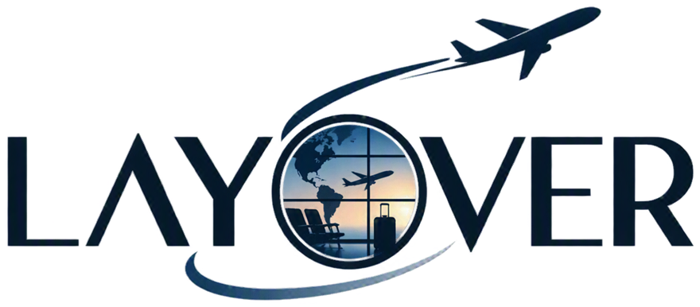
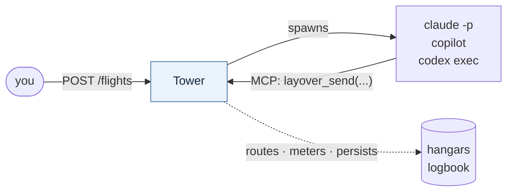

<div align="center">

<picture>
  <source media="(prefers-color-scheme: dark)" srcset="assets/logo-dark.png">
  
</picture>

**A local-first framework for running a lights-out agent factory.**

[](https://github.com/KotkaZ/layover-project/actions/workflows/ci.yml)
[](https://github.com/KotkaZ/layover-project/actions/workflows/pages.yml)
[](https://github.com/KotkaZ/layover-project/actions/workflows/release.yml)
[](https://github.com/KotkaZ/layover-project/releases/latest)
[](LICENSE)

[Documentation](https://kotkaz.github.io/layover-project/) ·
[Install](#install) ·
[Your first factory](#your-first-factory) ·
[Troubleshooting](https://kotkaz.github.io/layover-project/troubleshooting.html) ·
[Decisions](docs/decisions.md)

</div>

Layover does not call LLMs. It is a *supervisor*: it spawns headless agent CLIs — GitHub Copilot
CLI, Claude Code — gives them a way to talk to one another, persists what they learn, and stops them
from running away.

You describe a factory in a single `layover.toml` — which agents exist, what each one is for,
which agents may trigger which others, and how work gets in — and `layover serve` runs it
unattended: schedules fire, agents hand work to each other over MCP, a joined agent waits for every
verdict it needs, and every chain is bounded by the Hops, Fuel and run cap it started with. That
has been tested rather than asserted: a 48-hour soak driving the real Copilot CLI, one process, no
intervention — **1,501 runs, all succeeded** ([the 1.0 notes](CHANGELOG.md#100--2026-09-23)).
## Install

Layover is a single binary. No Rust toolchain needed.

```sh
# macOS / Linux — Homebrew
brew install KotkaZ/tap/layover

# macOS / Linux — no package manager
curl --proto '=https' --tlsv1.2 -LsSf \
  https://github.com/KotkaZ/layover-project/releases/latest/download/layover-cli-installer.sh | sh

# Windows
powershell -ExecutionPolicy Bypass -c "irm https://github.com/KotkaZ/layover-project/releases/latest/download/layover-cli-installer.ps1 | iex"

# ...or, since you probably already have Node for the agent CLIs
npm i -g https://github.com/KotkaZ/layover-project/releases/latest/download/layover-cli-npm-package.tar.gz

# ...or from crates.io, if you have a Rust toolchain
cargo install layover-cli
```

> **`layover-cli`, not `layover`.** The bare name belongs to an unrelated SSH tunnelling crate
> whose binary is *also* called `layover`. Install `layover-cli`; the binary it gives you is
> `layover`.

Archives for all five targets, with a `sha256.sum` covering them, are on the
[releases page](https://github.com/KotkaZ/layover-project/releases/latest). The
[install guide](https://kotkaz.github.io/layover-project/install.html) covers checking them, building from
source, installing the agent CLIs and starting a factory with the computer. A running factory tells
you when a newer Layover is out, and [updates itself](https://kotkaz.github.io/layover-project/updating.html)
when you ask.

## Your first factory

You need GitHub Copilot CLI, installed and signed in. Copy
[`examples/planner.toml`](examples/planner.toml) — three agents in a loop — into an empty
directory as `layover.toml`, and from there:

```sh
layover validate --strict   # check it before anything runs
layover serve               # run it; open the dashboard address it prints
```

On the dashboard, start the `build` workflow and give it a goal.
[Your first factory](https://kotkaz.github.io/layover-project/first-factory.html) walks through the file,
and [`examples/`](examples/README.md) has five more, up to the reference factory: nine agents, two
rendezvous joins and a review loop, with the arithmetic that sizes its rails.

> **Give a factory a CLI home of its own.** Its runs otherwise use yours — `~/.copilot`,
> `~/.claude`, `~/.codex` — filling your session history and loading your personal plugins and MCP
> servers. Set `COPILOT_HOME`, `CLAUDE_CONFIG_DIR` or `CODEX_HOME` for the Tower and forward it with
> `env_from`; see [the CLI's home](https://kotkaz.github.io/layover-project/runners.html#a-cli-home-of-the-factorys-own).

## The idea

Picture an airport grid.

Each **agent** is an airport. A message is a **Flight**. A chain of flights originating from one
trigger is an **Itinerary**, and it carries the two things that keep the network sane: **Hops**
(how many legs remain) and **Fuel** (how much budget remains). The **Tower** is air traffic
control. One supervised CLI execution is a **Run**; each agent keeps its own notes in its
**Hangar** and shares what everyone should know in the **Logbook**. Work an agent sets down to
pick up later is a **Layover**. When everything needs to stop, you call a **Ground Stop**.

## How it works



The [glossary](https://kotkaz.github.io/layover-project/glossary.html) has the rest of the vocabulary,
and [the book](https://kotkaz.github.io/layover-project/) how each part works.

## What it does not do yet

Agents are not isolated from one another — every agent shares one working directory — and Codex
cannot yet be told where Layover's MCP endpoint is. The book's
[Status](https://kotkaz.github.io/layover-project/#status) is the one place that lists what is and is not built; what is still undecided is in
[`docs/decisions.md`](docs/decisions.md#still-open).

## Project status

Maintained by [@KotkaZ](https://github.com/KotkaZ).

| | |
|---|---|
| **Stability** | [Semantic versioning](https://semver.org/) from 1.0: a breaking change to the configuration format, the HTTP API, the MCP tools or the on-disk layout needs a major version. The changelog flags anything an existing factory will notice, even in a minor release. |
| **Versions** | One version for every crate, the binary and the API. 1.0 was the first runnable release — the milestone where a factory runs unattended — and shipped after the 48-hour soak above. |
| **MSRV** | Whatever [`rust-toolchain.toml`](rust-toolchain.toml) pins, currently 1.98. It is the only toolchain tested, so claiming an older one would be a guess. Raised in a minor release. |
| **Platforms** | Developed on Windows, CI on Linux, released for both plus macOS. |
| **Changes** | [`CHANGELOG.md`](CHANGELOG.md) |

## Contributing

Contributions are welcome from humans and from agents, and the rules are the same for both:
[`CONTRIBUTING.md`](CONTRIBUTING.md) is the short version — setting up, the one command that
decides whether a change is done, and the crates — and [`AGENTS.md`](AGENTS.md) the full one.
Vulnerabilities go through [`SECURITY.md`](SECURITY.md) rather than the issue tracker.

## License

[Apache-2.0](LICENSE)