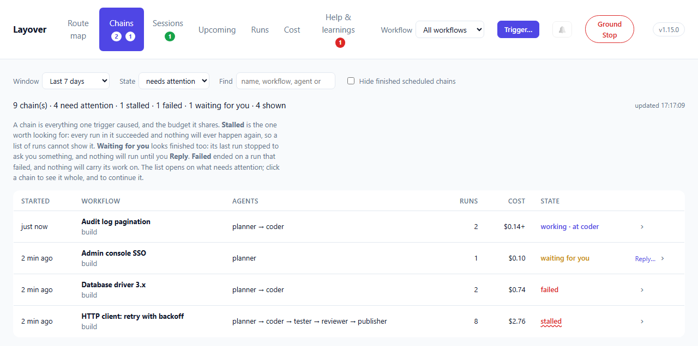
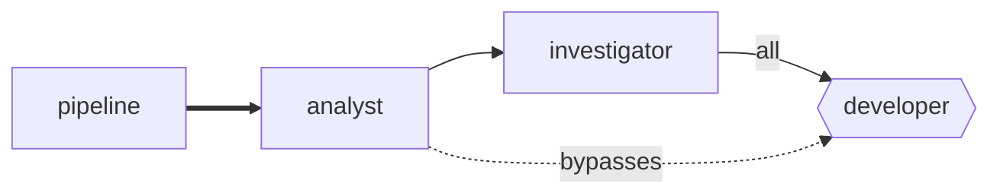

# Chains and the route map

Two views of the [dashboard](./dashboard.md): what one trigger caused, and what the factory is
wired up to do.

## Chains



A run is one agent doing one thing. A **chain** is everything one trigger caused, and the budget
they share — Hops, Fuel and the run cap are per chain, so "what did this cost" and "did this
finish" are questions about a chain rather than a run. A chain somebody named when they triggered
it is listed by its name, above its workflow.

| State | Meaning |
|---|---|
| `working` | Something is running, or waiting to |
| `finished` | It ran and stopped, and nothing is outstanding |
| `stalled` | It stopped and nothing will ever happen again |
| `waiting for you` | Its last run stopped to ask you something, and nothing will run until you answer (`awaiting_human`) |
| `failed` | Its last run failed, timed out or was interrupted, and nothing is queued or running after it |
| `halted` | A Ground Stop caught it, or the Reserve refused to start its run |

**`waiting for you` looks finished too.** Every run in it ended cleanly and nothing is queued —
because its last run filed a fatal help request and stopped. It has a **Reply…** beside it and an
amber count on the tab. Resolving the request without replying makes it `finished`; replying makes
it `finished`, continued by the chain the reply started.

**`failed` is a chain that simply stopped.** The run that would have sent the work on did not
finish — its tests failed, the model service dropped it and it was not restarted, it ran out of
time — so nothing is queued, nothing is stalled at a barrier, and no rail refused anything. It used
to read as `finished`, which is how three chains once sat dead overnight until somebody asked why a
pull request never appeared. Its detail says which run ended it and why:

```text
`wolf` failed, and nothing came after it: exited with code 1: the model service failed (http_400):
… ; not restarted: this agent's `recovery` policy is `manual`; a human decides
```

"Last" is the run that finished last, so a fan-out branch that failed while another went on to the
end does not make the chain `failed`. A chain whose run the model service ended and whose restart
is waiting out its back-off is `working`, and says so. A chain somebody has [continued](#chains) —
**Continue…** on its page — has been dealt with and is `finished`.

**Dismiss…** is for a stalled or failed chain somebody dealt with another way — the fix made by
hand, the work no longer wanted — so it stops asking for a person without anything running again.
It is beside such a chain in the list and on its page, and asks how it was dealt with and who you
are, both optional. The chain keeps its state, because that is still what happened, and reads
`failed · dismissed`, greyed, with `Dismissed by karl · 2 h ago: merged the fix by hand` on its
page. It leaves *needs attention*, the red count on the tab, the count in the page's title and the
notifications. **Undo dismiss** on its page puts it back.

A dismissal is of the run the chain ended on. If the chain goes on — restarted, say — and ends on
another failed run, or stalls again, nobody has seen that, and it needs attention again. Dismissals are kept with the journal, survive a restart, and go when retention
removes the runs they were about.

**Continue…**, on a chain's own page and in a run's report, opens the trigger window with that
workflow chosen and its flags set as that chain had them, saying where they came from. Change them
if you need to. A chain from before runs recorded their flags opens with the workflow's defaults,
and a warning that they are only that.

**`stalled` is the one worth looking for**, and the reason this view exists. A joined agent never
woke because the barrier it was waiting behind could no longer be completed — the tester reported,
the reviewer never did, and the publisher is still waiting for a verdict that is not coming.

Read as a list of runs, that chain looks perfect. Every run says `succeeded`. There is no failed
run to point at and nothing saying the last step never happened. So the Tower writes down the
moment it gives up on a rendezvous, and this is where that shows up:

```text
`publisher` never woke: nothing live could still deliver reviewer
```

A cost with a `+` after it is a floor rather than a figure: some run in the chain reported nothing,
so the real total is at least that much.

A chain is listed from the moment its first flight is queued. Trigger a workflow while every slot
is taken and it reads `working · queued`, with no runs yet, rather than not appearing until a slot
frees; one that is going says where it is — `working · at coder`. Click a chain — anywhere on its
row; the `›` at its end says so — to see it whole.

### Finding a chain

A factory with a few schedules starts hundreds of chains a week, almost all of them routine work
that finished. So the list **opens on what needs attention** — `working`, `waiting for you`,
`stalled`, `failed` and `halted`, less any somebody dismissed — and says how many it is not
showing: `864 chain(s) · 3 need attention · 1 failed · 2 dismissed`. The red count on the tab is the
stalled and failed chains nobody has dismissed: the ones nothing will move again by itself.
When nothing does, it says so, with a link to show every chain.

| Filter | Narrows to |
|---|---|
| **Window** | Chains started in it |
| **State** | *needs attention* (the default), *any*, or one state. A dismissed chain is listed under its state, not under *needs attention* |
| **Find** | Chains whose name, workflow, agents or identifier contain the words |
| **Hide finished scheduled chains** | Leaves out a schedule's chains that nobody named and that finished: the routine ticks |

The list is drawn fifty at a time, with **Show more** below it; a refresh keeps however many pages
were open.

## One chain, whole


Trigger a development workflow three times and its route map is still one drawing. It colours the
coder while *any* of the three runs it, so it says that the coder is running and not which of the
three is where. Opening a chain — from **Chains**, from a run's chain in **Runs**, from the buttons
under its workflow's map, or straight after triggering it — shows that chain on its own:

- **Its workflow's map, drawn for it alone.** The same drawing, so the two can be compared at a
  glance, coloured by what happened *in this chain*, with the routes its work actually took drawn
  in green and the rest faded. Each box says what its agent ran at *in this chain*: what its runs
  were recorded running at, or what was chosen when the chain was triggered — which can differ from
  the workflow's own map.
- **The flags it ran with**, as chips: those on, and any off that its workflow has on by default.
  A flag set otherwise than its workflow's default is marked `•` — that is what somebody chose
  when they triggered it — and the rest, off as by default, are counted rather than listed.
- **Against the clock**: a row per agent, each run a bar on one time axis from the chain's start —
  green, red for a failure, pulsing while it runs, a dashed outline for work waiting for a slot.
  What the list cannot show is plain here: which runs overlapped, how long work waited, and which
  pass took three times as long as the one before. Click a bar for its report, or to watch it.
- **Every run, in the order it happened**, with who sent it, how it ended, how long it took and
  what it cost, and **Watch** or **Transcript** and **Report** beside each.
- **What it is waiting for**: flights it has queued, at the end of the list.

| Drawn as | Means, in this chain |
|---|---|
| Pale green box | It ran here, and its last run here went well |
| Green box | It is running now |
| Red box | Its last run here failed, timed out, was interrupted or was halted |
| Dashed amber outline | Work for it is queued, waiting for a free slot |
| Faded box | Nothing in this chain reached it |
| Green line | A route this chain's work took |
| `×2` in a corner | It ran twice here — the coder on its second pass after a review, say |

The view keeps itself current every few seconds while the chain works, and stops asking once it
has stopped. Its address ends `#chain=itn_…`, so it survives a reload and can be sent to somebody.

**Sent by** says where each run's work came from: an agent, the `way in` (a trigger, a schedule or a
resumed layover), or `—` when that was not recorded. Runs from before this release, a join restarted
after the Tower that released it went away, and a run the Reserve refused do not know, and they
light no route rather than a guessed one — a route drawn from who happened to run before would look
exactly like one that was taken.

What it cannot show is a flight parked at a barrier: that lives only in the Tower's memory. The
upstreams that have reported show as done, and the joined agent wakes when the last arrives.

## The route map




Read it as: pipelines on the left, work flowing right, each agent in the column where it comes in
the work.

**Columns follow reading order, and the order you declare routes in shapes them.** Layover walks
the route map depth-first from the way in, visiting each agent's routes in the order `layover.toml`
lists them — routes as written, each route's `to` in order. A route back to an agent the walk has
not finished with closes a loop and is drawn as a route back; each agent then sits one column
right of the furthest thing that wakes it. A factory lists its routes roughly in the order its work
flows, so a workflow with shortcuts and loops still reads along its main path: an analyst allowed
to send straight to the operator for a rare message does not pull the operator into the analyst's
next column. Reorder the routes and the map changes; nothing the factory does changes with it.

Columns are therefore not hops. Hover an agent for its hop depth, measured exactly as
`layover validate` measures it: `1 hop from devforge's entry: woken by flight 2 at the earliest`.
On the whole-factory map every pipeline's entry starts the walk, by pipeline name, then every agent
triggered directly; an agent two workflows reach at different depths takes the deeper column, and
a spawn that closes a loop with another workflow's routes is drawn as a route back like any other.

| Drawn as | Means |
|---|---|
| Rounded box | An agent |
| Hexagon | An agent guarded by a rendezvous barrier |
| Thick indigo arrow | A pipeline feeding its entry agent |
| Blue arrow labelled `all` or `any` | An upstream the barrier waits for |
| Dashed violet arrow | A permitted sender the barrier *does not* name |
| Line with an arrowhead at each end | A route each way: either agent may send to the other |
| Line running across a column, between its boxes | A route that skips columns: it crosses each one at a height kept clear for it, and never through a box |
| Short line or arc beside a column | A route between two agents in the same column |
| Line under the columns it spans | A route back towards the way in: out to the right of its column, along a lane of its own just below the columns it spans, and up into the agent it returns to |
| Arrow labelled with pipeline names | A route only those workflows' chains may use — on the whole-factory map only |
| Green, amber, red fill | Running, waiting at a barrier, last run failed |
| `×2` in a box's corner | Two runs of it alive at once — the workflow triggered twice, say |

Amber needs the supervisor: nothing records a parked barrier yet, so today the map shows running
and recently-failed agents only.

A workflow's map is coloured by that workflow's runs. An agent it shares with another workflow is
not shown running here because the other workflow is running it; a run whose chain no workflow
opened — a review spawned by a sweep, say — could be anybody's, so it counts on every map its agent
is drawn on. Under the map, one button per chain the workflow has going says where each is —
`46TNEG at coder`, `GDTHVD queued for analyst` — and opens [that chain](#one-chain-whole).

That dashed arrow is the one worth dwelling on. A barrier constrains only the upstreams it names;
any other permitted sender wakes the agent directly and leaves the parked flights untouched. In
the reference factory the analyst's work item reaches the developer that way, while the tester's
and the reviewer's verdicts queue at the barrier — which is what lets one agent be both a join
target and an ordinary destination.

Most routes in a real factory come in pairs — an analyst asks an investigator and hears back — so
a pair of plain routes is drawn as **one line with an arrowhead at each end**. Only plain routes
are paired: a join, a spawn, or a scope that differs between the two directions says something the
other direction does not, so each keeps its own arrow. The review loop into a barrier, for
instance, is still drawn out and back.

### What each box says

Under an agent's name is the **model it runs on** and the **reasoning effort** it runs it at, and
under that its **context tier** and whether it is `read-only`:

```text
             bob
claude-opus-5.5 · effort xhigh
        long context
```

The model and its effort share a line because they are one choice: how hard *that* model is asked
to reason. A model name too long to share its line puts the effort at the start of the next, and a
box grows a third small line rather than cut anything off.

All of it is read from the command line Layover will run for that agent — its runner's `command`,
with the agent's own `model`, `effort` and `context` filled in — so two agents sharing one runner
each show their own, and a value fixed in the runner is shown as readily as one the agent
declares. See [what is reported](./runners.md#what-is-reported) for which flags are read. An
agent whose command line names no model or effort is drawn as it always was.

Hover over a box for the rest: its description, runner and access. `GET /agents` reports the same
`model`, `reasoning_effort` and `context` for each agent.

### Tracing one agent

A busy map is easiest to read one agent at a time. **Hover** over an agent — or tab to it — and its
routes and the agents at their other ends stay lit while everything else fades. **Click** it to
keep them lit; a panel opens under that workflow's map with what the agent runs on (model,
effort, context tier, runner, access) and who it **sends to** and **hears from** in this
workflow, with a link to its runs. Click it again, click empty space, or press Escape to let go.
Hovering a single route lights just that route and its two ends, and its tooltip says what it is:
`analyst ⇄ sherlock`, or `azurix → eagle · spawns a new itinerary · only in eagle-eye`.

"In this workflow" is exact: the panel reads the routes drawn on that workflow's map, which are
the routes its chains may use, so an agent shared by two workflows shows different neighbours in
each.

### One diagram per workflow

A factory usually holds several pipelines, and they are genuinely separate workflows. Drawn
together they read as one very confused process, so each gets its own diagram, stacked down the
page — or just the selected one, when the header narrows the page to it. Every diagram is drawn
at the same scale, its natural size, so a workflow of three agents is not blown up to look more
important than one of twelve; a diagram wider than the page shrinks to fit, and past a point the
page scrolls it rather than shrinking its text out of reading.

The busiest workflows come first — chains under way, then runs in the last week, with the order
of `layover.toml` breaking ties — and the order holds while the page refreshes itself, so a card
does not move while you read it. A factory of five workflows is five drawings tall, so a drawing
**folds away** (`▸`) to its card: the header, the week's numbers and the chains under way stay.
On a page of three or more workflows, one starts folded when nothing in it needs looking at —
nothing under way, nothing failed, nobody asked anything — and **Show every drawing** and **Fold
them all** do what they say. A drawing you fold or open stays that way in this browser.

Above each diagram is what that workflow has actually been doing: runs and spend over the last
seven days, failures, open help requests and, for a scheduled workflow, the ticks it skipped. The
diagram says what *may* happen; the strip says what did, and both questions get asked at the same
moment by someone who has just opened the page wondering whether anything is wrong.

Each carries the rails that bound a chain started there:

| Rail | What it bounds |
|---|---|
| **next** | Not a bound: when a scheduled workflow next fires, by the Tower's clock. See [What starts next](./dashboard.md#what-starts-next). |
| **hops** | **Depth.** Flights before the chain is cut. Branches inherit the count rather than splitting it, so it says nothing about width. |
| **fuel** | **Breadth.** The shared budget, honouring the entry agent's own `fuel_usd` where it sets one. |
| **workspace** | Whether two instances share a working directory or get one each. |

Both rails are shown together deliberately. Seeing Hops alone invites the assumption that it caps
spending, and it does not — a branching factor of three at `max_hops = 8` permits thousands of
paid invocations while every hop count stays legal.

An agent belonging to two workflows appears in both. That is the honest answer: the developer
really is in the triage pipeline and the follow-up pipeline, and hiding it from one would
misrepresent the factory to make a tidier picture.

Each diagram is drawn over the routes **that workflow's chains may use**: every global route, and
every route [scoped](./routes.md#scoping-a-route-to-workflows) to it. A route scoped to
another workflow is not drawn, and an agent only another workflow's routes reach does not appear.
So a shared agent appears in each workflow with only that workflow's edges — the review sweep's
map does not show the reviewer handing work to the builder when only the build workflow may. In a
factory with no scoped route, every diagram is exactly what it was.

The whole factory in one picture is `GET /graph` without a `pipeline`, or `layover graph`. There
every route is drawn, and an edge only some workflows may use is labelled with their names — in
the SVG it carries a `scoped` class and an "only in …" tooltip. The page itself keeps to one
diagram per workflow, for the reason above.

Cost gains a **By workflow** table for the same reason. Per-agent totals cannot answer "what does
the nightly sweep cost me" once an agent belongs to more than one.

The diagram is generated per request, so an edit to `layover.toml` shows on the map within fifteen
seconds, or at once on **Refresh**. `layover graph` prints the same graph without a server: Mermaid by default for
pasting into a README, `--svg` for the version the dashboard draws, and `--pipeline` for one
workflow's diagram.
