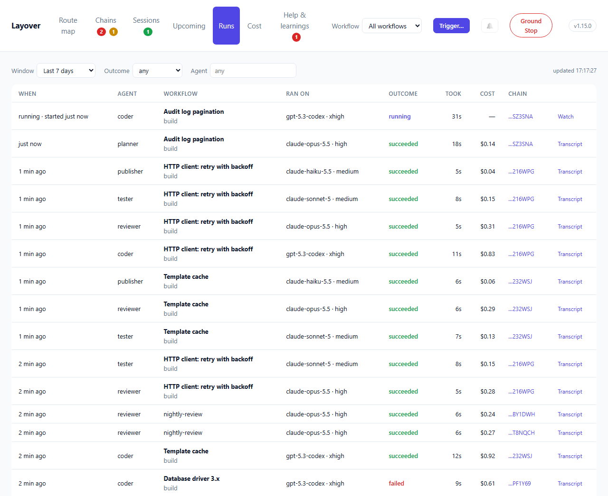
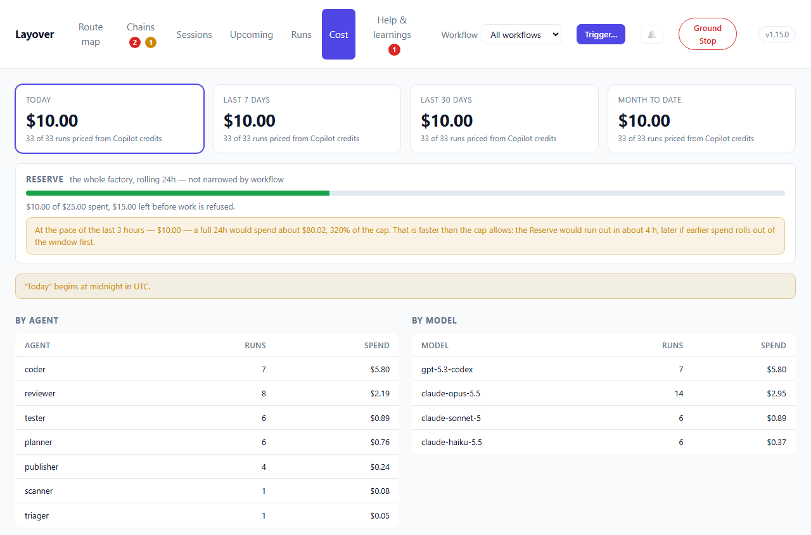

# Runs, cost and retention

Three views of the [dashboard](./dashboard.md): every supervised run, what they cost, and how long
any of it is kept.

## Runs



Every supervised execution, newest first, filterable by window, outcome and agent, a hundred at a
time with **Show 100 more** below. A running run says `running · started 4 min ago` rather than
when it finished. Each says which **chain** it belongs to — the end of its identifier, where
identifiers differ, with the chain's name in the tooltip — and clicking that opens the chain.
**Ran on** is the model and effort the run's command line gave it; hover it for the context too.

Each run keeps the **model, effort and context** its command line gave it, so history answers
"which effort did that run use?" without opening a transcript; a session's header shows them, and
`GET /runs` returns them as `model`, `reasoning_effort` and `context`. Runs recorded before Layover
kept effort and context have neither.

| Outcome | Means |
|---|---|
| `running` | Still going |
| `succeeded` | Exited cleanly |
| `failed` | Exited non-zero |
| `timed_out` | Hit `timeout_sec` and was killed |
| `halted` | A rail refused it: Hops, Fuel, the run cap or the Reserve |
| `interrupted` | Alive when the Tower went away — see [Recovery](./recovery.md) |

A failure that was not the run's own says whose it was. A run the model service ended — its last
call rejected or never answered, and nothing after it — is `failed` **· model service**, never
`succeeded`; `GET /runs` gives it `cause: provider_error` and the provider's `request_id`, and its
detail says what the service said and whether it is being
[restarted](./recovery.md#when-the-model-service-fails):

```text
exited with code 1: the model service failed (http_400): Execution failed: 400 internal server
error (Request ID: 00000-7a12…); restarting as attempt 2 after a 1-minute wait
```

`halted` is deliberately not coloured like a crash. A rail stopping work is the system doing its
job, and colouring it red teaches people to ignore red.

A run that exited on its own carries its **exit code**. A `failed` one also carries a one-line
`detail`: how the process exited and the line of its output most likely to be the reason —
the last line that says *error* or *failed*, or failing that the last thing it printed:

```text
exited with code 1: Error: Failed to read MCP config file "…\mcp.json": The system cannot find
the path specified.
```

The line is picked, not summarised — Layover calls no model — and it is redacted and capped at
300 characters before it is written, because a transcript is where a CLI that failed to
authenticate prints what it tried. The whole transcript stays in the run's Hangar. Hover a row to
read the detail.

A run whose cost the runner never reported shows **not reported**, never `$0.00`. The two are
different facts, and the difference decides whether the budget rail is working.

## Cost



Seven windows, of two kinds, and the distinction is part of the answer rather than a detail.

| Window | Kind |
|---|---|
| Today, Month to date | **Calendar** — begins at local midnight |
| Last 24 hours, 7 days, 30 days, 90 days | **Rolling** — a fixed number of hours ending now |
| All time | Everything still kept |

A rolling window is the same length everywhere on earth. A calendar window is not: "this month"
begins at midnight *somewhere*, and the page names the zone it used. Rolling windows say they used
none, and that absence is deliberate — nobody should have to wonder which zone "last 7 days" meant.

Conflating the two is not a theoretical hazard. Gating spend on a UTC day boundary while reporting
the ledger in local time lets a factory spend one day's money twice, and the bug is invisible
until it matters.

Every total carries its provenance, shown next to the figure rather than tucked away:

- *"all measured"* — every run's cost was measured: dollars the runner printed.
- *"n of m runs priced from Copilot credits"* — also measured: Copilot reported the AI credits those
  runs used, and they are priced at `[copilot] usd_per_credit`. Named so that the arithmetic stays
  visible.
- *"n of m runs priced from a rate card"* — part of this is an estimate.
- *"n of m runs reported nothing"* — part of this is a hole, and the total is a lower bound.

A total with a hole in it is never shown as a plain figure. It carries a `+` — `$12.40+` — and one
where *every* run reported nothing reads **not reported** rather than `$0.00`, here, in the
breakdowns and in each workflow's **spend, 7d** on the route map. A plain `$0.00` beside runs that
did work is how a factory whose runner prints no cost comes to look free; `layover doctor` says
which runner it is and what to add to its command.

The weakest source wins. A figure that is 90% measured is still not measured, and saying so is the
entire point of tracking where a number came from. The page says once, under the cards, what a `+`
means whenever one is showing.

Click a card to look at that window; its address keeps it, `#cost?window=last_7d`. Below the
Reserve, for any window longer than a couple of days, **Day by day** draws a bar per day — the
days nothing ran on included, so a gap reads as a gap — with the peak and the daily average. Days
begin and end at midnight where the Tower is, and the page names the zone. A day with a run that
reported nothing has a dashed top, because its bar is a floor; the first and last days of a rolling
window are partial, and today's bar is lighter for being unfinished.

Beside **By workflow**, **Most expensive chains** names the ten pieces of work that cost the most
in the window — one level below the agent, so "the reviewer is expensive" becomes "this review of
this PR was". Click one to open it.

### The Reserve

Below the window cards is the Reserve: the factory's own ceiling, over its own rolling window.

It is drawn apart from those cards because it answers a different question over a different
period and a different scope. The cards say what something *cost*, over the window you picked,
for the workflow you picked. The Reserve says what may *still be spent*, over the hours
`[reserve] window_hours` names, across every workflow at once.

Putting it among figures that narrow would invite reading it as one of them — and a spending rail
misread as covering less than it does is worse than one not shown at all. It says on its face that
it is not narrowed.

A factory whose `[reserve] fuel_usd` is `0` has no ceiling, and the meter is hidden rather than
drawn empty. One that writes no `[reserve]` at all has the default, $100 in any rolling 24 hours.

Under the meter is its **pace**: the last three hours' spend, as it would be over the Reserve's
whole window — `At the pace of the last 3 hours — $36.41 — a full 24h would spend about $291.31,
3% of the cap.` A factory spending faster than the cap allows is told roughly when it would run
out. Read from every workflow's runs, as the Reserve is.

The meter is the same figure the Tower checks before every run. When it is full, new runs are
refused and their chains show as `halted`, with the reason and the time the window frees room — see
[Cost](./cost.md#what-happens-when-the-reserve-runs-out).

## Retention

History is kept for **90 days**, in `.layover/history`, as one JSON Lines file per UTC day.

Retention is applied when `layover serve` starts, not on a timer. A process left running for
months therefore keeps more than ninety days until it is next restarted — the horizon is a floor
on what is kept, not a ceiling.

Deleting is therefore deleting whole files — no rewriting, no compaction, and no window where
history is half-pruned because the process died in the middle of it. A window reaching further
back than 90 days reports a lower bound and says so.

### What else the horizon reaches

| Path | Holds | Pruned? |
|---|---|---|
| `.layover/history/runs-*.jsonl` | One record per run | Yes, whole files |
| `.layover/journal/help-*.jsonl` | Help requests | Yes, whole files |
| `.layover/journal/skips-*.jsonl` | Scheduled ticks that were skipped | Yes, whole files |
| `.layover/hangars/<agent>/run_*/` | A run's prompt and transcript | Yes, whole directories |
| `.layover/hangars/<agent>/memory.md` | What the agent wrote for itself | **No** |
| `.layover/journal/learnings.jsonl` | Every learning | **No** — but a lapsed one is deleted after `[learnings] keep_lapsed_days` |

Hangars are pruned by the age encoded in the run's own identifier rather than by the file's
modification time. A run id is a ULID, so it carries the millisecond it was minted; asking the
name is exact, where asking the filesystem is a guess that a copy, a restore or a backup tool
would get wrong.

A directory in a Hangar that Layover did not mint is **left alone**, whatever its age — its age is
unknown, and deleting on a guess is how somebody's own notes disappear.

`memory.md` sits beside those run directories and is never pruned, for the same reason learnings
are not: an agent's accumulated knowledge should not get worse for being old.

> This gap was found by the 48-hour soak, not by a test. Hangars grew without bound while
> everything around them was pruned — and after ninety days a factory held transcripts for runs
> whose records had been deleted, which is evidence attached to nothing.

The files are plain text, one JSON object per line, and are meant to be read:

```console
$ tail -1 .layover/history/runs-2026-09-16.jsonl
{"run":"run_01K...","itinerary":"itn_01K...","agent":"developer","pipeline":"development",
 "outcome":"succeeded","started_at":"2026-09-16T10:00:00Z","finished_at":"2026-09-16T10:04:30Z",
 "usd":1.25,"source":"reported","usage":{"input":18402,"output":3100,...},"exit_code":0,
 "sent_by":["analyst"]}
```

`sent_by` names the agents whose flights started the run — every arrival, for a released join — and
is `[]` for work from outside the mesh. It is absent from records written before it was kept.
