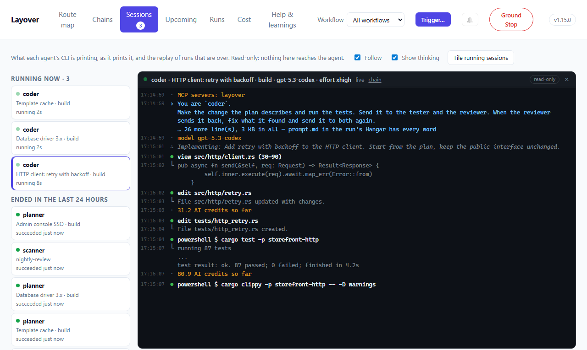
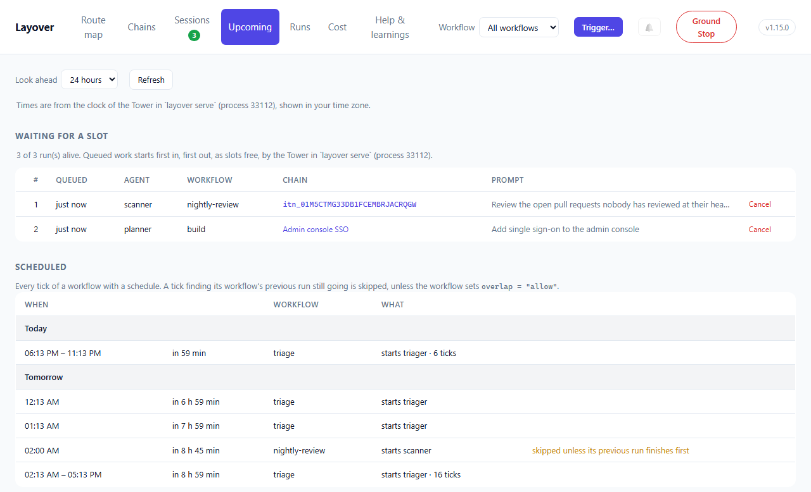

# The dashboard

A factory that runs unattended raises three questions, and they are the three things this page
answers.

- **What is it wired up to do?** The route map, drawn from `layover.toml` as it is on disk.
- **What has it been doing?** Run history, for as long as retention keeps it.
- **What is that costing?** Totals over periods you can actually reason about.

The [Chains and the route map](./dashboard-chains.md) and [Runs, cost and retention](./dashboard-runs.md)
views have pages of their own.

```console
$ layover --config layover.toml serve
Layover dashboard on http://127.0.0.1:7878
Reading layover.toml
History in .layover/history
Press Ctrl+C to stop.
```

## One workflow at a time

A factory holds several pipelines, and they are separate workflows that happen to share agents. A
page that totals them together answers a question nobody asked: "is the build healthy" is about one
of them, and reading it off a combined figure means doing the separation by eye.

The **Workflow** selector in the header scopes the whole page — the route map, runs, what is
coming up, cost totals and breakdowns, and help requests. It defaults to *All workflows*, and it is
hidden entirely when a factory declares only one.

Two things deliberately do not narrow:

| | Why |
|---|---|
| **The Reserve** | It caps the factory. Charging one workflow's spend against a ceiling that covers all of them would report a rail that does not exist. |
| **Learnings** | A learning belongs to an *agent*, and an agent can appear in several workflows. Filtering them by workflow would invent an attribution the model does not have. |

### Every view has an address

The page keeps what you are looking at in its address — the tab, the workflow and that tab's
filters — so a reload, a bookmark or a link sent to a colleague opens it as you left it:

```text
http://127.0.0.1:7878/#runs?status=failed&workflow=eagle-eye
http://127.0.0.1:7878/#chains?state=stalled&window=last_30d
http://127.0.0.1:7878/#journal?agent=wolf&q=kusto
```

The route map, Chains and Runs keep themselves current every fifteen seconds while they are on
screen — each says when it last read the Tower, `updated 14:03:05` — and catch up at once when you
come back to a tab left in the background. Sessions, Upcoming and an open chain keep faster clocks
of their own. A refresh keeps your place: the pages of a list you had open, and an agent you had
clicked on the map.

Changing tab is a step in the browser's history, so **Back** returns to the last tab; changing a
filter is not, so Back is not buried under every keystroke. A chain keeps its own address,
`#chain=itn_…`. A filter left at its default is left out of the address, and an address naming a
workflow or a filter value the factory no longer has falls back to the default.

Help requests carry a workflow even though they do not store one: a request records the itinerary
that raised it, an itinerary belongs to exactly one pipeline, and the runs already in the window
supply the mapping. Where retention has taken the run but not the request, the workflow reads as
`—` rather than being guessed at.

## Triggering a workflow

**Trigger…**, in the header beside the Ground Stop on every tab and beside each workflow on the
route map, opens a window with the pipeline, a prompt box, and a toggle for every flag that pipeline
declares — each starting from its declared default, so the window shows what would happen if you
changed nothing. It says which agent the prompt goes to — `Starts at analyst` — and what the
workflow is for.

The window opens on the workflow whose button you pressed; from the header, on the workflow the
page is showing, or failing that the one last triggered from this browser. Workflows started by
hand are listed before those on a schedule, which can be triggered too but seldom are. One that
only resumes layovers has no entry agent, so there is nothing to start and it is not offered. A flag the pipeline does not declare is refused rather than ignored:
silently dropping it would let a typo change nothing while appearing to work. A workflow
[switched off](#switching-a-workflow-off) cannot be triggered until it is switched back on.

**Name** it, optionally — `Login page: retry banner` — and that is what the run is called wherever
it appears: the Chains list, the chain's own page, Sessions, Upcoming and Runs. Three DevForge runs
going at once are three names rather than three identifiers. The name stays with everything the
run causes — its hand-offs, a chain it spawns, a follow-up days later, and the work a reply to one
of its help requests continues — and is kept in each run's record. A Copilot run's session is
called by it too (`--name`), with the agent after it, so you can find it among your own sessions.

**Model, effort and context for this run** lists every agent the workflow runs, with what each runs
at now — the workflow's values, `[pipelines.<name>.agents.<agent>]` included. Type a different value
to run that agent differently in this run and everything it causes; leave a box empty to keep it. A
box is disabled where the agent's runner has no placeholder to carry the value, because a choice its
CLI would never see is worse than none, and the Tower refuses one that arrives anyway. Values are
the CLI's, typed as it takes them; the suggestions are only values already used in the factory.

**The work is queued, and the Tower starts it.** Under `layover serve` it starts as soon as a slot
is free, and the window names the Tower that will pick it up. Once it is queued the page opens
[the chain it started](./dashboard-chains.md#one-chain-whole), so you watch that run of the workflow rather than the
workflow. Above the workflows a line reads
`2 of 4 run(s) alive · 3 flight(s) queued`, kept current every few seconds — the difference between
a busy factory and a stuck one. A dashboard started with `--watch-only` runs nothing and says so:
`dispatched_by` is `null` rather than a plausible name, so a queue never looks like it is moving
when nothing here is moving it. A Ground Stop refuses the trigger outright — a kill switch that halts running work while
letting more be booked is not a kill switch.

## Watching agents work



**Sessions** shows every run that is going now, and the ones that ended in the last day, each as
its CLI would show it in a terminal: the first lines of what it was asked, its reasoning, every
tool it called with a few lines of what came back, and what it said. Text the model is still
writing appears as it arrives, and is replaced by the finished message. A session that ends says
how — `succeeded`, `failed`, `timed out` — and a finished one replays from the start, which is how
you see the route an agent took to its conclusion rather than only the conclusion.

Opening the tab with nothing picked opens the newest running session, so what is happening now is
on screen at once; once you pick or close one, the page stops picking for you. A terminal's header
links to the run's **chain** and, once it is over, to its **report**.

**Tile running sessions** puts every running session side by side, up to four, and adds new ones as
they start. **Show thinking** hides the reasoning when you only want the actions; **Follow** keeps
each terminal at its latest line. The green number on the tab is how many runs are alive. In
**Runs**, a running row has **Watch** and a finished one **Transcript**; so does a report.

It is **read-only**. There is nowhere to type, and an agent cannot tell it is being watched: the
dashboard reads the transcript the Tower already writes to each run's Hangar, so it works the same
from a `--watch-only` dashboard beside a running `serve`.

What is shown is rendered, not raw. A forty-minute Copilot review writes tens of megabytes, most of
it the same text twice — once token by token, then whole — and the page shows each thing once.
Tool output is cut to its first lines and the prompt to its first two; the whole of both are in the
run's Hangar (`.layover/hangars/<agent>/<run>/`). Credentials are masked the way they are in a
run's failure detail. Copilot CLI's JSON events and Claude Code's `stream-json` are understood;
anything else — Codex, a script — is shown as it was printed.

## What starts next



**Upcoming** answers what will happen without anybody pressing anything, in the order it will
happen, over the next 6 hours to 7 days:

- **Waiting for a slot** — work already queued, first in first out, with its position, the agent it
  goes to, its chain and the first line of its prompt, and **Cancel** for each. Above it,
  `2 of 4 run(s) alive` and what starts the queue. A restart after the model service failed waits
  out its back-off here, and says when it starts — `restarts 14:05` — rather than when it was
  queued.
- **Scheduled** — every tick of every workflow with a schedule, grouped by day: when, how long
  until, and what it does — `starts analyst`, or for a resuming workflow `picks up 1 layover`. A
  run of ticks of one workflow with nothing to say about them is folded into one row
  (`10:00 – 10:23 · starts poller · 24 ticks`), so a one-minute schedule does not bury the hourly
  one. A tick is marked when its workflow's previous run is still going — *skipped unless it
  finishes first* — and when it is held: a tick that comes due during a Ground Stop fires once, the
  moment it is released, and the ones after it count from then.
- **Layovers** — work an agent set down, what it is waiting for, the chain that set it down, when it
  is due, and **when it will actually be picked up**: the first tick of a resuming workflow after it
  is due, which can be most of an interval later. With no resuming schedule it says *never*.
- **Skipped ticks** — every tick in the last seven days that found its workflow still working, and
  a count per workflow. A schedule that skips every tick has a quiet history — few runs, nothing
  failed — and this is where it shows.

**The times are the Tower's.** An `every` schedule counts from when the Tower started, so a page
working the times out for itself would be wrong by however long ago that was. A `--watch-only`
dashboard has no clock and says so; its queue, layovers and skipped ticks are still shown.

The same clock puts **next** beside each scheduled workflow's trigger on the route map — `next
14:00 · in 23 min`, amber when that tick may be skipped — and the strip under it gains **skipped
ticks, 7d**.

## Reading what an agent did

Every row on **Runs** opens the report that agent wrote about its own run: a headline, the body,
and the artifacts it produced.

A report is not a transcript. A transcript contains every approach the agent abandoned, and reading
one to find out what happened is slower than doing the work again. Asking the agent to state its
conclusion also makes it decide what its conclusion was.

Reports are capped and trimmed rather than refused — a report is the only account of a run that has
already cost money — and a trimmed one says so, so you know to look further rather than assuming
the agent stopped there. The caps are a 160-character headline, a 12,000-character body and 32
artifacts; a learning is capped at 400 characters, and at most 25 are injected into any one run,
unless [`[learnings]`](./configuration.md#learnings--how-learnings-live) says otherwise.

## Switching a workflow off

Every workflow has an **On / Off** switch beside its name on the route map, scheduled or not. Off
closes its ways in:

| | While it is off |
|---|---|
| Its schedule | Ticks pass without firing. They are not recorded as skipped: the workflow says it is off wherever it is shown, which is the thing a skip record exists to make visible. |
| Triggering it | Refused, from the trigger window and from `POST /flights`. The window says so as soon as the workflow is picked, before anybody writes a prompt. |
| A resuming workflow | Collects nothing. Its layovers wait, and **Upcoming** says they are picked up once it is switched back on. |
| A trigger already queued | Waits in the queue, marked *held*. Its chain reads **halted** with the reason. Cancel it from **Upcoming** if it should not run at all. |
| Chains already under way | **Finish.** Their hand-offs, spawned chains, restarts after a crash and the work a reply to their help requests continues are never held. |

Switched back on, a trigger it held starts as soon as a slot is free, and its schedule fires at its
**next** tick: the ones that passed while it was off are not made up, because work starting at a
moment nobody chose is the thing the switch was flipped to prevent. **Upcoming** shows when that
next tick is while the workflow is still off.

Neither direction asks for confirmation. Off starts nothing, and on starts nothing at once except
what it held — unlike releasing a Ground Stop, which restarts everything. To stop work that is
already running, that is still what the Ground Stop is for.

The switch is kept in `.layover/journal/switched-off.jsonl`, one line per workflow that is off, so
it survives a restart and the Tower reads it on every pass. When nothing is answering, add
`{"pipeline":"review-sweep"}` to that file by hand, or delete the line to switch it back on. A
flight sent straight to an `entry = true` agent belongs to no workflow, so no switch holds it.
[`layover doctor`](./cli.md#doctor) names every workflow that is off.

## Stopping it

Two different things stop, and the header shows both. A **Tower asked to stop** — a Ctrl+C in its
terminal, or [`layover stop`](./cli.md#stop) — drains: nothing new starts, what is running finishes,
and then the process exits. The version pill gains `· stopping`, in amber, while it does. A
**Ground Stop** halts the factory without stopping the Tower.

The **Ground Stop** button is in the header, not behind a tab, because the moment you want it is
the moment you do not want to go looking for it. Pressing it halts everything: running agents are
ended, and no new work starts.

It is a pause, not a stop. Parked work is kept, so engaging a Ground Stop to look at something and
then releasing it resumes where the factory was. Releasing asks for confirmation; engaging does
not — stopping should be easy and starting again should be deliberate, because the cost of a
Ground Stop nobody meant is a pause, and the cost of releasing one somebody did mean is whatever
they engaged it to prevent.

It is a file on disk rather than state in memory, so it survives a crash and can be set by hand
when nothing is responding. The Tower reads it on every pass, so it takes effect within seconds
rather than at the next restart.

Queued work can be cancelled individually, from **Upcoming**. Only work that has *not started*: a run already going
is stopped with a Ground Stop, which is a different decision with a different blast radius — one
flight versus the whole factory — and saying "cancelled" about something still opening pull
requests is the most dangerous thing this surface could say.

The read-only half needs no Tower at all. History outlives the process that wrote it, so the
dashboard answers for a factory that is not currently running — which is exactly when you most
want to know what it did. `layover serve --watch-only` serves that half alone.

## A newer Layover

When this machine has learned of a newer release, the version pill in the header says so —
`v1.14.0 → 1.15.0` — and opens a window with what it changes: whether it is a patch, minor or major
release, when it was released, its Compatibility note — what an existing factory will notice — and
all its release notes. Once it is [staged](./updating.md#staging-a-release), the window also
says how far staging got — downloaded and matched, who built it, or why it stopped — and what the
release made of this factory: validated with no new warnings, validated with warnings this version
does not give, or refused.

Staged, verified and validating the factory, it can be installed from here: **Update now** asks the
Tower to [install it](./updating.md#installing-a-release) — let what is running finish, start
nothing new, swap its binary and restart on the new version. While it does, the pill reads
`· updating` and a line above every view says what it is waiting for, with **Cancel** to call it
off before the swap. **Skip this version** stops it being offered on this machine, and after an
update **Roll back to …** goes back to the version it replaced, while that is kept. A `--watch-only`
dashboard has no Tower to ask, and says so. With [notifications](#knowing-when-it-needs-you) on, the
bell rings when a newer release is found, when an update proves healthy, and when one is rolled
back.

The pill reads what the Tower last found, on [its schedule](./configuration.md#update--hearing-about-a-newer-layover):
opening the page asks GitHub nothing, and a `--watch-only` dashboard says the same as the Tower's.

## Knowing when it needs you

A factory runs unattended, so the page is usually in a background tab when an agent stops to ask
something. The badges on the tabs only help somebody already looking. So the tab's **title** counts
what needs a person — open help requests, and stalled and failed chains nobody has
[dismissed](./dashboard-chains.md#chains), `(3) Layover` — where it
can be seen from the tab strip; a chain waiting for you is already counted, since what it waits on
is an open help request. The counts are kept current every thirty seconds whichever tab is showing.

The bell (🔔) beside the Ground Stop asks the browser to **notify** you when a chain starts waiting
for you, a chain stalls or fails, or an agent asks for help. It is off until you turn it on, and the browser
asks first; turning it on is remembered in this browser. Clicking a notification opens what it is
about. Browsers only notify from a secure page, which `http://127.0.0.1` is and a dashboard reached
over plain HTTP from another machine is not — there the bell does not appear.

## Answering an agent

An agent that cannot get past something raises a **help request** rather than guessing. Those are
in the Help &amp; learnings tab, each with **Reply** and **Resolved**.

**Reply answers it and continues the work.** The window opens with what the agent asked, quoted, so
you can answer between its questions. Sending starts a new run of the agent that asked — a new
chain, with a fresh budget, in the same workflow with the same flags, routes, name and per-agent
choices as the chain that asked. Never the workflow's defaults: a chain that was allowed to open a
pull request still is, and the window says which flags it carries. The agent is told a person sent it, and its work begins with
a line naming the request it answers, then your words exactly as you wrote them:

```text
In reply to your help request run_01M3… (spec needs 3 decisions from the product owner)

> 1. Exponential or linear back-off?
Exponential.
```

The request is marked dealt with, recording who replied — the name you give, which the browser
remembers, or the account the dashboard runs as — what you said, and the chain it started. On the
Chains tab each of the two chains names the other. A request filed before Layover recorded its
chain's flags cannot know them, so the window asks you to set them: they start from the workflow's
defaults and it says so, and the reply is refused until it has them.

**Resolved says the blocker is gone**, not *I have read this*. Nothing checks: if it is not actually
fixed, the next run raises it again, which is what keeps the list evidence of something rather than
a queue somebody clears to feel tidy. But a request that *stopped* its run ended its chain, so there
is no next run: resolving one restarts nothing, its button says so, and Reply is the way on.

Learnings sit below them, with `Keep` and `Drop`. **Neither is an approval step.** A learning
applies from the moment an agent proposes it; these say "this is real, stop it lapsing" and "this
is wrong, stop giving it to runs". Dropping asks for confirmation because it takes something out
of every future run; keeping does not, because it only preserves what is already happening. A
lapsed learning shows when it will be **deleted** — `[learnings] keep_lapsed_days` after it lapsed —
unless an agent rediscovers it first.

The list opens on the learnings **in use** — provisional and confirmed — since those are the ones
runs are being given. **Standing** shows the others, with how many of each there are; **Agent** and
**Find** narrow it to one agent, or to the learnings that mention something.
## Why it looks like this

No npm, no framework, no build step. The page is HTML, CSS and a little vanilla JavaScript,
embedded in the binary, and the graph is SVG generated in Rust.

Three reasons, all pointing the same way. Layover ships as **one binary** to five targets,
installed by people not expected to have a Rust toolchain let alone a Node one. The graph layout
is a **pure function with unit tests**, rather than a 2.5 MB JavaScript dependency whose output
could only be eyeballed. And it has to work **offline**, on a machine left running overnight,
which rules out a CDN.

The choice is reversible: the page only consumes the HTTP API, so replacing it later changes
nothing behind it.
