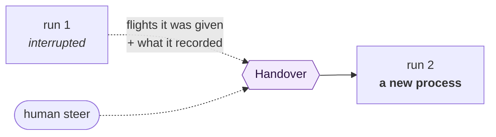

# Recovery and steering

A run can stop before it finishes — the machine restarts, Layover is shut down while a child
process is still working, or the model service rejects a call and the CLI gives up. And a run going
the wrong way sometimes needs a human to redirect it.

Both are handled the same way: **Layover starts a new run and hands it what the old one had.**
Nothing is resumed, and no process is kept alive to be talked to.



Every run is therefore still a clean slate *process*, exactly as an ordinary one is. What a
handover changes is only how much context the new run **opens** with.

## What a handover carries

| | |
|---|---|
| **Why** | An interruption, or a human's instruction |
| **The flights** | The work item again — the new process remembers nothing |
| **What was recorded** | Whatever the earlier run managed to write down, explicitly not a complete record |

For a restart, the new run is told what happened and warned before repeating anything that changes
the world:

```text
## You are continuing interrupted work

A previous run (run_01ABC) started this work and did not finish: the Tower restarted while it
was running. This is attempt 2.

You are a new process and remember none of it. Before repeating anything that changes the world
— a commit, a comment, a published pull request — check whether the earlier run already did it.
Doing it twice is worse than doing it late.
```

For a steer, the human's instruction is carried with its precedence stated, because steering that
does not override the original request is only a suggestion:

```text
## A human has redirected this work

A previous run (run_01XYZ) was working on this. Their instruction takes precedence over the
original request where the two disagree:

> Use the existing retry helper, do not write a new one.
```

## Recovery is a rail, not a reflex

A recovered or steered run is an **ordinary run**: it spends a hop, debits Fuel, counts against
`max_runs` and draws on the Reserve. A crash loop that restarts itself forever is a fork bomb that
looks like resilience.

```toml
[defaults]
max_recovery_attempts = 2   # 0 disables automatic recovery entirely
```

Attempts are counted per piece of work, across every restart of it for whatever reason, and carried
on the queued flight so a Tower that restarts in the middle cannot forget them. Restarting is
refused when:

| | |
|---|---|
| A **Ground Stop** caused the interruption, or is engaged when it is decided | A factory that restarts through its own kill switch is not one anybody can stop |
| The attempt limit is reached | See above |
| The agent's policy says not to | See below |

## Doing the work twice is not always safe

```toml
[agents.publisher]
recovery = "manual"
```

| Policy | Meaning |
|---|---|
| `automatic` | Restart without asking, up to the limit. The default. |
| `manual` | Record the interruption and wait for a human to ask. |
| `never` | Do not restart. The itinerary stays interrupted. |

The question is not whether the Tower *can* restart an agent but whether doing its work twice is
safe. Reading and reporting is harmless to repeat. Opening a pull request is not — a run
interrupted after it pushed a branch but before it recorded that it had would, on restart, open a
second one.

There is no reliable way to detect that from the route map: "is terminal and writes" is a
topological guess at a semantic property, and it fires on plenty of factories where repeating is
fine. So Layover does not guess. It does two things instead: the default handover **tells the
agent to check before repeating a side effect**, and `recovery` lets you stop the restart entirely
for the steps where checking is not good enough.

The reference factory sets `recovery = "manual"` on its publisher, and nothing else.

## When the model service fails

A Copilot run can finish a 35-minute verification matrix and then die on its next model call: the
service answers `400 internal server error`, Copilot CLI does not retry a 400, and the process exits
1. The work did not fail — it was interrupted — so Layover treats it like a run the Tower went away
from:

1. **It tells the two apart from the CLI's events.** A failed run is a *provider error* when the
   last thing its CLI reported was a model call the service rejected or never answered, and nothing
   after it shows the run carried on. For Copilot CLI that is a `model.call_final_result` whose
   `result` is not `success` (`http_400`, `http_503`, `transport_error`, …), a `session.error` whose
   `errorType` is `query`, or both — with no tool started and no call succeeding after them.
   Bookkeeping after the error (`session.usage_checkpoint`, `assistant.idle`, a background task's
   output) does not count as carrying on.
2. **It records the run as `failed`**, never `succeeded`, with `cause: provider_error`, the
   provider's request id, and a detail saying what the service said and what happens next:

   ```text
   exited with code 1: the model service failed (http_400): Execution failed: 400 internal server
   error (Request ID: 00000-7a12…); restarting as attempt 2 after a 1-minute wait
   ```

3. **It applies the agent's `recovery` policy and `max_recovery_attempts`**, exactly as for an
   interruption: `automatic` restarts it, `manual` records it and waits for a person, `never` leaves
   it. A Ground Stop engaged when the run ended forbids the restart.
4. **The restart waits**: a minute before the first, five before the second, fifteen after that. A
   provider fault often comes in a cluster, and restarting into it would spend an attempt on
   nothing. The wait is kept on the queued flight, so a Tower restarted meanwhile still waits, and
   [Upcoming](./dashboard.md#what-starts-next) says when it starts. `layover run` waits for it too.
5. **The restart is an ordinary run** on the same flight, in the same chain: Hops, Fuel, `max_runs`
   and the Reserve all apply, and a Ground Stop holds it. It is told the model service failed, and
   that everything the earlier run did before that may have taken effect:

```text
## You are continuing interrupted work

A previous run (run_01M4X…) started this work and did not finish: the model service failed mid-run
(request 00000-7a12…). This is attempt 2.

It was not the work that failed: a call to the model service was rejected or never answered, and
the run ended there. Everything it did before that — commands it ran, files it changed, commits,
comments, messages it sent — may well have taken effect.

You are a new process and remember none of it. Before repeating anything that changes the world
…
```

**Only a provider error is restarted.** A run that failed its own work — a test that failed, a
command its runner denied, an exit for any reason the CLI's events do not attribute to the service —
would fail the same way again, so it is recorded and left; see [why](./design/decisions.md).
A run that outlived `timeout_sec` is `timed_out`, never a provider error.

**It is read from events, never from text.** Only the top-level fields of each JSON event the CLI
prints are looked at. An agent quoting an error — a tool result holding a log that says
`session.error`, a message explaining a 400 — is a string inside another event and never matches,
which a pattern over the output would.

### Which runners are read

| Runner | Read for provider errors |
|---|---|
| `cli = "copilot"`, or a `command` that runs Copilot CLI by name with `--output-format json` | Yes, as above |
| `cli = "claude"`, a Claude Code or Codex `command` | Not yet: Layover has no reader for their events, and guessing would restart runs that failed for their own reasons |
| Anything else | Only if the runner declares how |

A runner says otherwise with `provider_errors`. `read = "copilot"` reads a wrapper that runs Copilot
CLI under another name; `read = "none"` turns the reading off; and a runner for a CLI Layover has no
reader for declares the events itself:

```toml
[runners.mine]
command = ["my-cli", "--json"]

[runners.mine.provider_errors]
failed     = [{ type = "error", error.kind = "provider" }]  # the service failed a call
carried_on = [{ type = "tool_call" }, { type = "message" }] # the run went on after one
request_id = "error.request_id"                             # where the provider's id is
```

Each entry is the fields an event must have, with these values; a table matches the object at that
field the same way. A failed run is the service's when the last event matching `failed` comes after
the last matching `carried_on`. See [Configuration](./runners.md#telling-the-model-services-failure-from-the-runs).

**On by default.** An agent's `recovery` already says whether repeating its work is safe, and it
defaults to `automatic`, so a factory that never mentioned recovery now restarts a run the service
dropped — up to `max_recovery_attempts`, which defaults to `2`. To keep a factory's earlier
behaviour, set `max_recovery_attempts = 0` (which also stops restarts after a Tower restart), give
the agents whose work must not repeat `recovery = "manual"`, or set `provider_errors = { read =
"none" }` on a runner.

## After a restart

A Tower stopped with Ctrl+C or [`layover stop`](./cli.md#stop) drains first — nothing new starts, and
it exits once what it is running has finished — so it leaves nothing to settle. One that goes away
any other way — a reboot, a crash, a closed terminal, a second Ctrl+C — leaves a record of every run
it was watching. The next Tower to open the factory, `layover serve` or `layover run`, settles each one
before it starts anything:

1. **It makes sure the process is gone.** A run still alive is cut off — its MCP endpoint and token
   died with the Tower that minted them, so nothing it sends, reports or books can arrive — and is
   stopped along with everything it started. A process identifier since reused by another program
   is recognised by its start time and left alone.
2. **It writes the run to history** as `interrupted`, priced from what its transcript reported, with
   a detail saying what was found.
3. **It restarts the work** where the agent's `recovery` policy and `max_recovery_attempts` allow and
   no Ground Stop is engaged: the same flight, in the same chain, told the handover above. The
   interrupted run's spend is charged to the chain first, so being interrupted cannot buy a chain a
   fresh budget. A workflow [switched off](./dashboard.md#switching-a-workflow-off) does not hold
   the restart: the chain was already under way, and those finish.

```text
`eagle` (run_01M3…) was interrupted by a restart: it was still running, cut off from Layover, and
was stopped; restarted as attempt 2
```

A run another living Tower is watching is left alone.

A run left behind by Layover 1.3.0 or earlier did not record its work, so it cannot be restarted.
It is written to history as `interrupted` with the detail *lost when the Tower stopped … Re-trigger
it if it is still needed*, ending when its transcript was last written rather than when it was
found, and in the workflow its chain's other records name, when any do. Each Tower holds a lock on a file of its own,
which the operating system releases however the Tower ends, and every run's record names it.
`layover run --dry-run` settles nothing.

A chain's Fuel and run count live in the Tower's memory, so a chain continuing after a restart
starts from its configured budget again — less what the interrupted run spent.

## Installing a release

[Installing a release](./updating.md#installing-a-release) into a running Tower waits for what
is running to finish, up to `[update] max_drain`. A run still going at that deadline is cut off and
settled exactly as above: recorded `interrupted`, and restarted where its agent's `recovery` allows —
on the new version. An agent whose `recovery` is `manual` is the exception: its work must not happen
twice, so while one is running at the deadline the install is postponed instead, and the Tower
carries on. With `max_drain` at least as long as the longest `timeout`, the default, nothing alive
when the drain began is still alive at the deadline; `validate` warns when it is shorter.

If the install then fails and the Tower carries on, it settles the runs it cut off itself, at once.

## A chain that ends on a failure

Whatever the cause, a chain whose last run failed, timed out or was interrupted — with nothing queued
or running after it, and nobody having continued it — is `failed` on the dashboard: in the Chains
list's *needs attention*, in the count on the tab and in the page's title, and in the bell's
notifications. It used to read as `finished`. Restarting a provider error removes the most common
cause; this is what makes the rest visible. See [Chains](./dashboard-chains.md#chains).

## Status

Recovery after a restart and after a model-service failure is built on everything above. Steering
has its handover, and nothing yet that lets a person send one.
