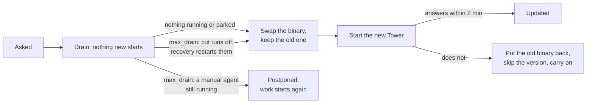

# Updating Layover

A running factory asks github.com once a day whether a newer Layover has been released. When one
has, the dashboard's version pill reads, say, `v1.15.0 → 1.16.0` and opens what it changes,
`layover doctor` says so, and `layover update check` asks at once. Nothing is downloaded and
nothing changes until somebody asks — unless the factory's
[`[update]`](./configuration.md#update--hearing-about-a-newer-layover) says otherwise.

| You want | Do |
|---|---|
| To know what a newer release changes | `layover update check`, or open the version pill |
| To install it | `layover update apply`, or **Update now** in that window |
| To have each release made ready as it is found | `[update] mode = "stage"` |
| To have it installed with nobody watching | `[update] mode = "auto"` — a patch after a day, a minor after two, never a major |
| To go back | `layover update rollback`, within `keep_previous` (a week) |
| To see what happened | `layover update log` |
| Nothing at all | `[update] mode = "off"`, or `LAYOVER_UPDATE=off` for the whole machine |

Each command is described under [`layover update`](./cli.md#update).

## How it hears of a release

The Tower looks once per `check_every`, a day by default. Each look is one request for a public file
on github.com — the newest release's `dist-manifest.json` — which sends nothing about the factory:
only the address it comes from and a `User-Agent` of `layover/<version>`. The `prerelease` channel
also asks GitHub's API for the list of releases. What was found is kept per machine, not per
factory, so two factories served by one installation ask once between them: in
`%LOCALAPPDATA%\layover\updates` on Windows, `~/Library/Application Support/layover/updates` on
macOS, and `$XDG_STATE_HOME/layover/updates` (by default `~/.local/state/layover/updates`)
elsewhere.

Three environment variables apply to every factory on a machine, whatever `[update]` says:

| Variable | Effect |
|---|---|
| `LAYOVER_UPDATE=off` | No request is made at all — not by the Tower, not by `layover update check`. Set it in CI and on a machine that must not reach out. |
| `LAYOVER_UPDATE_SOURCE` | Fetch releases from a mirror laid out as GitHub's releases are: `<url>/latest/download/dist-manifest.json`, `<url>/download/<tag>/<file>`, and the API's release list at `<url>/releases.json`. For sites that cannot reach GitHub, and for tests. |
| `LAYOVER_GITHUB_TOKEN` | A token for GitHub's API, for the `prerelease` channel behind a NAT whose sixty unauthenticated requests an hour are spent. Never `GITHUB_TOKEN`, which is usually a token meant for something else. |

None of the three reaches an agent: a child's environment is [scrubbed](./runners.md#credentials-for-the-cli-itself)
as it always was.

## Installing a release

[`layover update apply`](./cli.md#update), or **Update now** in the dashboard's
[update window](./dashboard.md#a-newer-layover), installs the staged release — staging it first if
it is not — once it is verified and validates the factory. Nothing installs on its own.

With a Tower serving the factory, the Tower does it, between runs:

1. **It drains**, as for [`layover stop`](./cli.md#stop): nothing new starts, what is running
   finishes, a scheduled tick that comes due is held.
2. **At `max_drain`**, a run still going is cut off — killed, recorded `interrupted`, and restarted
   on the new version where its agent's [`recovery`](./recovery.md) allows. Except: when an agent
   whose `recovery` is `manual` is still running — work that must not happen twice — the install
   is **postponed** instead, and the Tower carries on. `--now` reaches the deadline at once.
3. **It swaps** the binary in its own directory: the new one in, the old one renamed beside it as
   `layover-<version>.exe.old` (or `layover-<version>.old`), kept for `keep_previous`. A tick held
   while draining is queued for the new Tower.
4. **It hands over.** On Windows, and anywhere not run by a service manager, the old Tower closes
   its dashboard, starts the new binary with the same arguments at the same address, and waits up
   to two minutes for it to answer as the new version — then exits. If it does not answer, or
   exits, the old Tower stops it, puts its own binary back, stops offering that version, and
   carries on serving. Under systemd or launchd the old Tower exits 75 instead, and the service
   manager starts the new binary; the new Tower that cannot prove itself within ten minutes, or
   by its second start, puts the old binary back itself and exits 75 again.
5. **The new Tower proves itself**: it loads the factory, goes once round its loop and answers its
   own `/health` as the new version. It keeps the old Tower's dashboard token, so a page already
   open keeps working, and writes what it prints to `.layover/serve.log`.

## Staging a release

Under `mode = "stage"`, or when a person runs [`layover update stage`](./cli.md#update), a newer
release is made ready to install, one step at a time, each only if the one before it passed:

1. The release's manifest names an archive for this platform.
2. The archive, downloaded with a 64 MB cap, has the SHA-256 the manifest lists, and the `.sha256`
   file beside it agrees.
3. Its GitHub attestation says Layover's release workflow built it from the release's own tag,
   checked by [`gh attestation verify`](https://cli.github.com/manual/gh_attestation_verify) — so
   `gh` must be installed and signed in.
4. The archive holds the binary, and nothing that would unpack outside where it is put.
5. The binary, run for the first time — with no credentials in its environment and twenty seconds
   to answer — says it is the version and platform it should be, and that it can be reached from
   the version running.
6. It validates this factory. Errors refuse it; a warning the running version does not give holds
   back an unattended install and is shown before a manual one; a warning the factory always had
   holds nothing back.

**Nothing downloaded runs before step 3 has verified it.** Without `gh`, or with `gh` signed out,
a release is downloaded and checked against its SHA-256 and stops there; `layover update stage
--trust-checksum-only` runs it on its checksum alone, for a person who chooses that. A release whose
attestation `gh` refuses goes no further, whatever is said.

A staged release is kept per machine — one at a time, in `staging/<version>/` under the update
directory above — and what it made of each factory in that factory's `.layover/update/gate.json`.
A refused one is tried again at the next check. Staging installs nothing.

## Installing unattended

Under `mode = "auto"` the Tower does what `layover update apply` would, by itself, when all of these
hold — and says once, in its output, why not while one does not:

- the release is a patch, or a minor under the default `allow = "minor"` — **never a major**;
- it reads the **same state-directory layout**;
- it is **`min_age` old**: a day for a patch, two days for a minor, by default;
- it is **staged and verified** — unless `require_provenance = false` — and **validates the factory
  with no warning the running version does not give**;
- it is **in the `window`**, or, with none, the factory has been **idle for `idle_for`**.

Then it drains and installs exactly as above. An install begun in a window that closes before what
is running has finished is **postponed** to the next window, rather than cut off; one that does not
happen for any other reason is tried again an hour later. A release unattended installs would not
take — a major one, a layout change, a new warning — is still offered, and `layover update apply`
installs it. `LAYOVER_UPDATE=off` stops all of it on a machine.

With no Tower serving the factory, `apply` replaces the binary at once; the next Tower to start
runs the new version. One a package manager installed — Homebrew, npm — is left to it, with the
command to run; one in a directory you cannot write is never elevated into. Every install, refusal,
postponement and rollback is written to `.layover/updates.jsonl`, which
[`layover update log`](./cli.md#update) prints.

## Who replaces the binary

How Layover was installed decides who replaces it. A binary from the shell or PowerShell installer,
from `cargo install`, or from a manual download is replaced by Layover itself, with the prebuilt
binary of the release — so a Cargo install becomes a prebuilt one. One from Homebrew or npm is left
to them: Layover says to run `brew upgrade KotkaZ/tap/layover` or `npm install -g
@layover/layover-cli@<version>`. One in a directory you cannot write is never elevated into.

## Under a service manager

Started by the logon task on Windows, a Tower hands over to the new version in place, and keeps
running after the task's own command has ended. Under systemd or launchd it exits 75 for the service
to start the new version: regenerate an older service file with `layover autostart` so it says so
(`LAYOVER_SUPERVISOR`), though a systemd service is recognised without it.
